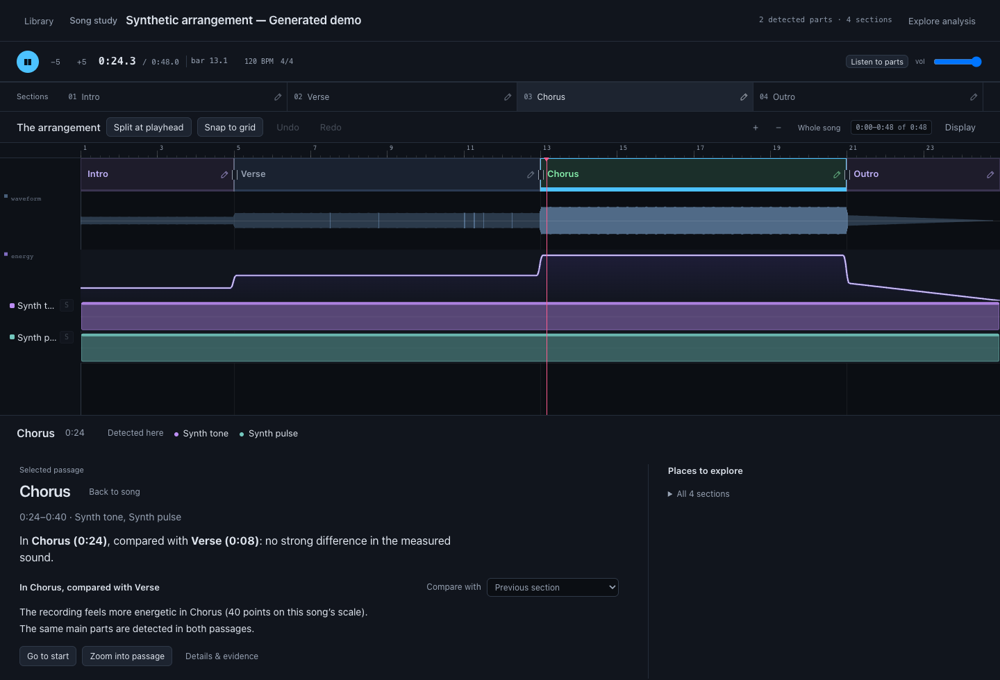

# Song Study

A local workspace for studying a recording's arrangement: sections, source activity, energy, stereo measurements, and optional commentary linked to measurements.



Song Study has a React/FastAPI web workspace and a native SwiftUI Mac workspace. The analysis code remains packaged as `arrangement-analyzer`; its import path is `arrangement`.

## Try the offline demo

Use Python 3.12+, Node.js 22+, and ffmpeg/ffprobe. The demo creates invented tones and a labeled timeline, so you can try playback and section editing without a model download, copyrighted recording, or provider account.

```sh
git clone https://github.com/arkravitz/song-study.git
cd song-study
python3.12 -m venv .venv
source .venv/bin/activate
pip install -e '.[dev]'
npm ci --prefix frontend
npm run build --prefix frontend
python examples/create_demo.py
ARRANGEMENT_DATA_DIR="$PWD/.demo-data" ARRANGEMENT_ALLOW_DOWNLOAD=0 arrangement-server
```

Open http://127.0.0.1:8848 and choose Synthetic arrangement. Play, scrub, split a section at the playhead, rename it, or compare two passages. The fixture's energy and labels follow the generator. They are explicitly **not inference results or an accuracy benchmark**.

For a smaller demo-only environment, install `requirements-demo.txt` in a Python 3.12 virtual environment, run the same frontend and generator commands, then launch with:

```sh
PYTHONPATH=backend ARRANGEMENT_DATA_DIR="$PWD/.demo-data" ARRANGEMENT_ALLOW_DOWNLOAD=0 python -m arrangement.server
```

The minimal environment supports the supplied playback demo, not real-song analysis. Use the full installation above for new analyses or the complete test suite.

## Analyze your own audio

The full installation uses Demucs for source estimates, Beat This/local structure as the portable fallback, and optional All-In-One MLX on Apple Silicon. First analyses may download weights and take several minutes. DeepSeek commentary is optional. Copy `.env.example` to `.env` if you want to configure it; the rest works without an API key. See [analysis setup and configuration](docs/development.md).

Audio, model weights, local libraries, and analysis caches are excluded from this repository. Use recordings you have permission to process and share.

## Engineering decisions

- Measured audio descriptors and interpreted section names are distinct. Source separation is an estimate; stereo-master measurements cannot recover original pan controls.
- Commentary references are checked against known times, sources and numbers, with unsupported claims marked in the interface. These checks are heuristic, not a guarantee of factual accuracy.
- Large curves and waveform pyramids are stored as binary artifacts and served by range. The UI avoids transferring full raw audio arrays as JSON.
- Section edits preserve macro passage identity, recompute window measurements, and retain internal detector landmarks. Portable regressions cover edited fragments and genuinely misplaced positional labels.
- Native playback uses disk-backed audio on a shared timeline, while a private Python worker owns analysis and storage.

## Verify

```sh
pytest backend/tests desktop/worker/tests -q
npm test --prefix frontend
npm run build --prefix frontend
```

On macOS 14+, with Xcode command-line tools:

```sh
swift test --package-path desktop
swift build --package-path desktop -c release
```

CI checks the backend/worker, frontend, and native source. Tests use generated arrays/audio and synthetic section fixtures; no private song library or paid model call is required.

## Native app

See [native build and usage](desktop/README.md). The source is included, but this repository does not ship a notarized installer, model weights, or a bundled Python/FFmpeg runtime. Full `.app` packaging remains a local development workflow with platform and redistribution limitations.

## Scope and attribution

Built with AI coding assistance. Analysis and model quality are experimental. The energy curve is relative to a recording, not a calibrated universal measure of musical intensity. A convincing UI does not establish transcription, separation or section-label accuracy.

Project source is MIT licensed. External packages, tools and model checkpoints have separate terms; see [THIRD_PARTY_NOTICES.md](THIRD_PARTY_NOTICES.md). No third-party checkpoint or song is bundled.
